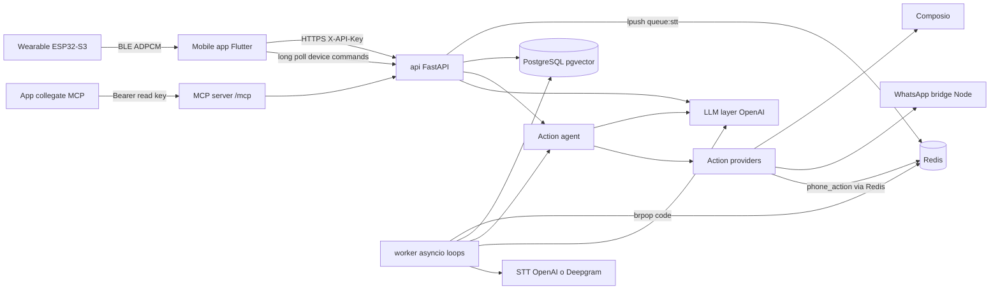
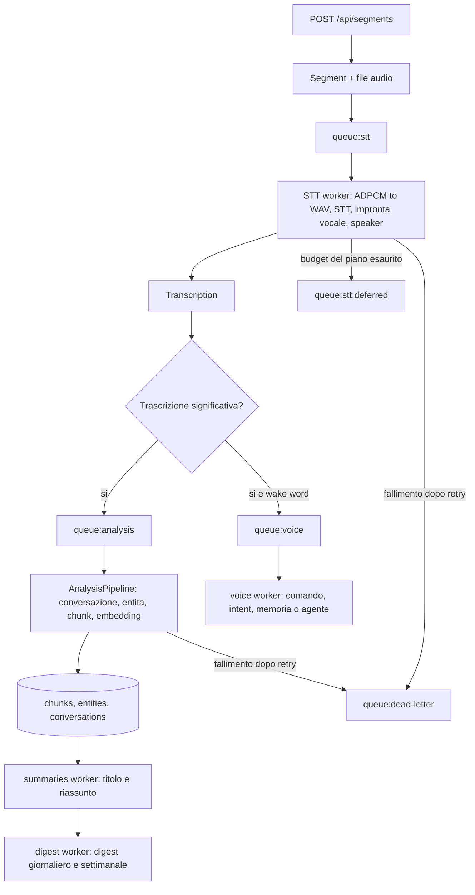
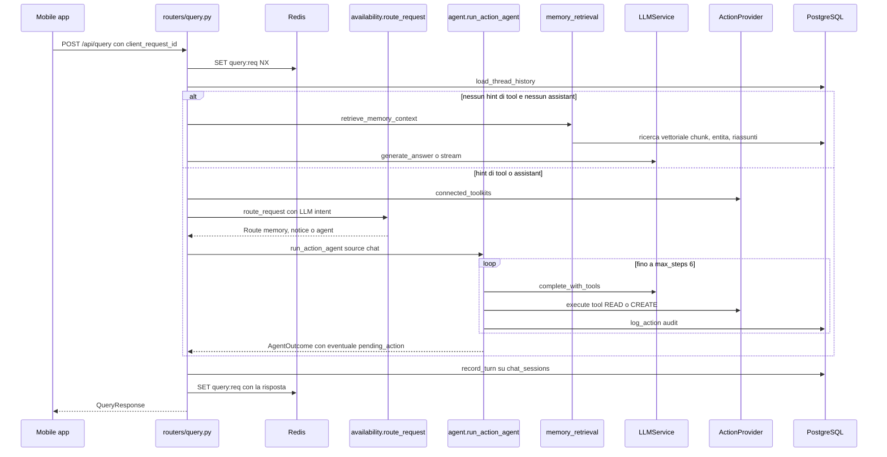
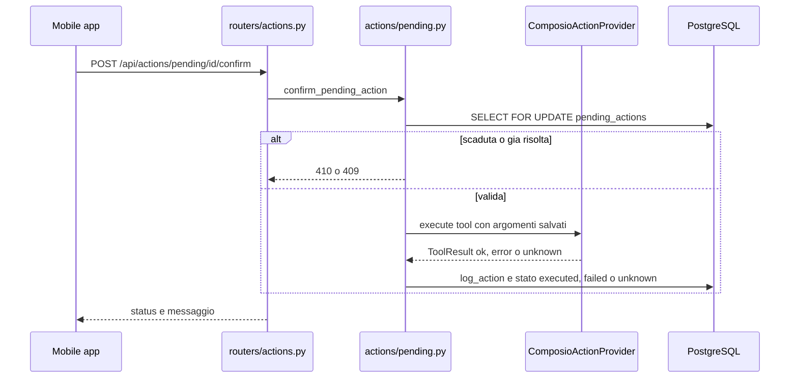
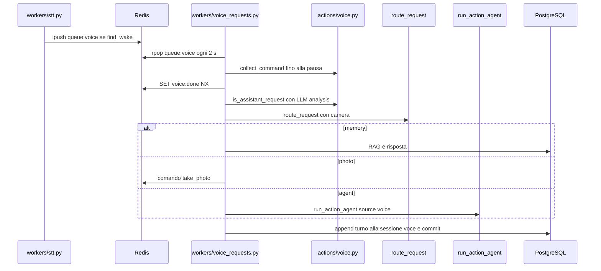
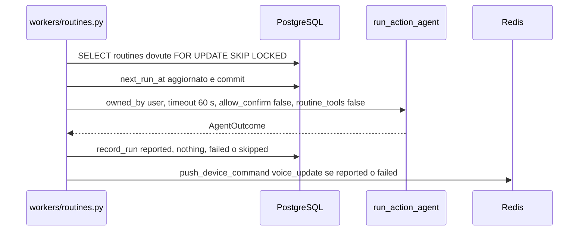
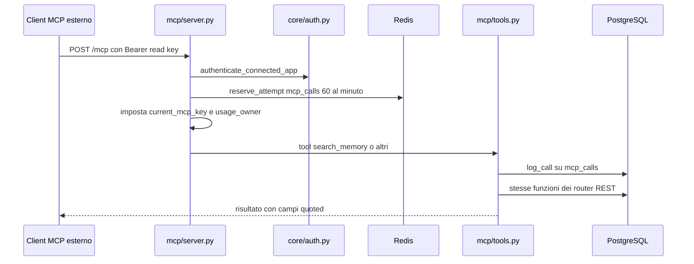

# Architecture — Echo

## Architecture Analysis

### System Overview

Echo è composto da quattro parti eseguibili più l'infrastruttura:

- **Wearable** (`firmware/`, ESP32-S3, Arduino + NimBLE): VAD, buffer PSRAM, codifica ADPCM, invio dei Segment al telefono via BLE con ACK; OTA firmata.
- **App mobile** (`mobile/`, Flutter): relay BLE → HTTPS, UI, long poll dei comandi del server, esecuzione di `phone_action` (EventKit su iPhone).
- **Backend** (`backend/`, Python 3.11): un'unica immagine Docker avviata in due processi:
  - **`api`** — FastAPI/uvicorn (`app.main:app`): REST sotto `/api`, SSE, server MCP su `/mcp`, `/health`, `/metrics`.
  - **`worker`** — `python -m app.workers.main`: 13 loop asyncio nello stesso processo (STT, analisi, rianalisi, voce, foto, routine, riassunti, digest, documenti, retention, saved, places, deferred).
- **Bridge WhatsApp** (`whatsapp/`, Node 22 + Baileys): servizio interno in sola lettura sulla rete compose.
- **Infrastruttura**: PostgreSQL 16 + pgvector (dati e vettori), Redis 7 (code, idempotenza, cache, comandi dispositivo, contesto chat), Cloudflare Tunnel (esposizione), OpenAI/Deepgram/Composio (servizi esterni).

### Architectural Style

**Monolite modulare con worker asincrono** ("store-then-analyze", ADR 0003). Evidenze:
- Un solo package Python `app` condiviso da `api` e `worker`; i moduli si importano direttamente (nessuna RPC interna).
- Disaccoppiamento temporale tramite **liste Redis** usate come code FIFO (`lpush`/`brpop`), con dead letter queue (`queue:dead-letter`) e retry con backoff (`workers/retry.py`).
- **Layer di astrazione dei provider** (ADR 0004): `LLMService`, `EmbeddingService`, `STTService`, `ActionProvider`, `WebSearchProvider` con implementazioni concrete (oggi solo OpenAI/Deepgram/Composio).
- Microservizio separato solo dove serve un runtime diverso (bridge WhatsApp in Node).
- Deploy single-host con Docker Compose; porte su `127.0.0.1`, accesso pubblico solo via tunnel.

### Component Relationships

<!-- Text fallback: Wearable invia audio via BLE all'app; l'app chiama l'api via HTTPS con X-API-Key; le app collegate chiamano il server MCP con una chiave read, che gira dentro l'api; l'api scrive su Postgres e mette i Segment in coda su Redis; il worker consuma le code Redis, scrive su Postgres e chiama STT e LLM; api e worker usano l'agente delle azioni, che chiama il layer LLM e i provider di azioni (Composio, bridge WhatsApp, azioni del telefono via comandi Redis che l'app preleva con long poll). -->

### Data Flow

<!-- Text fallback: un Segment caricato va in queue:stt; il worker STT lo trascrive (con impronta vocale e speaker) e, se il testo è significativo, lo mette in queue:analysis e, se contiene la wake word, anche in queue:voice; l'analisi assegna la conversazione, estrae entità e crea chunk con embedding; i riassunti e i digest vengono dopo; oltre il budget del piano la trascrizione va in queue:stt:deferred; i fallimenti dopo i retry finiscono in queue:dead-letter. -->

Isolamento per utente: ogni tabella di dominio ha `user_id` e ogni query lo filtra (es. `memory_retrieval.retrieve_memory_context`, `chat_history.context_key`, `pending._load_locked`). Non ci sono FK verso `users` né RLS: l'isolamento è applicativo.

### Key Design Decisions

| Decisione | Dove | Implicazione per un'architettura multi-agente |
|---|---|---|
| Un solo motore agente, parametrizzato per contesto | `actions/agent.run_action_agent` (parametri `source`, `routine_tools`, `allow_confirm`, `assistant`, `connected_toolkits`, `language`) | Base naturale per un coordinatore: i "sotto-agenti" esistono già come profili (Assistant) e come configurazioni dello stesso loop |
| Instradamento a una chiamata LLM | `actions/availability.route_request` → `Route(kind="memory"\|"notice"\|"agent"\|"photo")` | È già un dispatcher; oggi sceglie tra percorsi, non tra agenti |
| Conferme come regole nel codice | `actions/policy.classify_tool` / `classify_call`, `actions/pending.py` | Il confine di sicurezza va preservato in qualsiasi delega |
| Difesa da prompt injection | flag `untrusted` e `_LASTING_OWN` in `actions/agent.py`, campi `quoted` in `mcp/tools.py` | Va propagata ai sotto-agenti (contenuti letti = dati, non istruzioni) |
| Provider componibili | `WithPhoneApps`, `WithWhatsApp`, `NO_APPS` | Modello di "registro di strumenti" per utente già esistente, ma statico nel codice |
| Proprietario dei costi in ContextVar | `services/usage.usage_owner`, `owned_by()` | Ogni attività delegata deve impostarlo, altrimenti costi "unowned" |
| Idempotenza delle richieste | `routers/query._claim_request` (Redis `query:req:*`), `voice:done:*` | Previene doppie azioni su retry; da estendere ai passi delegati |
| Audit che sopravvive al rollback | `actions/audit.AuditRecorder`, `restore_audit` | Pattern riusabile per tracciare passi di agenti |
| Resilienza solo nei worker | `workers/retry.retry_with_backoff` + `core/circuit_breaker.openai_breaker` | Il percorso sincrono dell'agente non ha retry/timeout/breaker propri |
| MCP solo come server | `mcp/server.py` (FastMCP stateless, 60 chiamate/min per chiave) | Echo come client MCP è in ROADMAP, non implementato |

### Improvement Opportunities

- Tracing end-to-end: il correlation ID nasce nel middleware HTTP (`main.correlation_id_middleware`) ma non viaggia nelle code né nei passi dell'agente/tool.
- Metriche: `core/metrics.Metrics` è in memoria e il worker non le espone; nessuna metrica per LLM, tool, agente.
- Resilienza uniforme: timeout/retry/breaker per provider (non un breaker globale "openai" condiviso anche da Deepgram) e anche sul percorso sincrono.
- Stato condiviso: rate limit, cache Composio, breaker e metriche sono per processo; Redis è già disponibile come backend comune.
- Esecuzione durevole: il loop dell'agente non salva i passi; un riavvio perde il lavoro in corso (voce: messaggio di fallimento; routine: run `failed`).
- Isolamento: FK/RLS su `user_id` ridurrebbero il rischio di errori applicativi; il timezone utente è globale (`settings.user_timezone`).

## Interaction Diagrams

### Chat: memoria o agente (`POST /api/query`)

<!-- Text fallback: l'app invia la domanda; il router marca la richiesta in Redis per l'idempotenza e carica la cronologia; senza parole che suggeriscono tool (e senza assistant) fa RAG sulla memoria e genera la risposta; altrimenti legge le app collegate, chiede all'instradatore LLM se serve memoria, una risposta fissa o l'agente; l'agente esegue fino a 6 passi di tool calling, eseguendo tool di lettura/creazione e registrando l'audit, e restituisce la risposta o una pending action; infine il turno viene salvato in Postgres e la risposta in Redis per i retry. -->

### Conferma di una pending action

<!-- Text fallback: l'app conferma una pending action; il servizio la blocca con SELECT FOR UPDATE; se è scaduta o già risolta risponde 410/409; altrimenti esegue il tool con gli argomenti salvati, registra l'audit e aggiorna lo stato a executed, failed o unknown. -->

### Richiesta vocale "Ehi Echo"

<!-- Text fallback: il worker STT mette in queue:voice i segmenti con la wake word; il worker voce li preleva ogni 2 secondi, ricompone il comando fino alla pausa, si assicura di gestirlo una sola volta, verifica con il modello che sia davvero rivolto a Echo, lo instrada (memoria, foto o agente) e aggiunge domanda e risposta alla sessione vocale; in caso di errore ripristina l'audit e scrive un messaggio di fallimento. -->

### Esecuzione di una routine

<!-- Text fallback: ogni minuto il loop delle routine reclama quelle dovute con SKIP LOCKED e sposta la prossima esecuzione; per ognuna esegue l'agente come utente proprietario, con timeout di 60 secondi, senza strumenti che chiedono conferma e senza strumenti di routine; registra l'esito in routine_runs e, se ha qualcosa da dire o è fallita, avvisa il telefono con un comando voice_update. -->

### Chiamata MCP da un'app collegata

<!-- Text fallback: un client MCP esterno chiama /mcp con una chiave read; il server la autentica, applica il limite di 60 chiamate al minuto in Redis, imposta utente e proprietario dei costi nelle ContextVar e invoca il tool, che registra la chiamata in mcp_calls e riusa le funzioni dei router REST, restituendo il testo delle persone in campi quoted. -->
