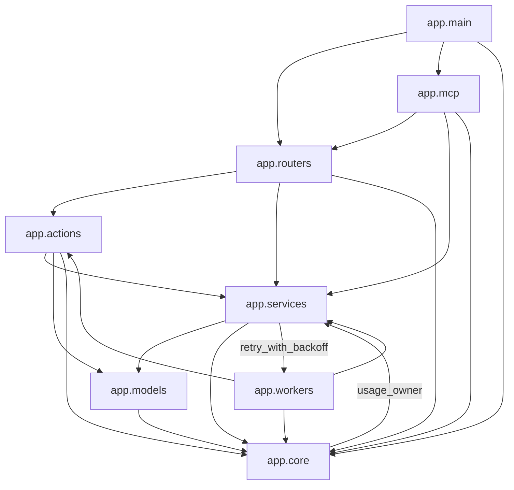

# Dependencies — Echo

## Dipendenze esterne (servizi)

| Servizio | Usato da | Modalità di errore gestita |
|---|---|---|
| OpenAI (LLM, embedding, STT, web search) | `services/llm_openai.py`, `embedding_openai.py`, `stt_openai.py` | Nei worker: `retry_with_backoff` + `openai_breaker`. Nel percorso API/agente: nessun retry/breaker applicativo (default dell'SDK); `classify_request` ripiega sulla memoria in caso di errore |
| Deepgram (STT alternativo) | `services/stt_deepgram.py` | Stesso `retry_with_backoff`, quindi stesso breaker "openai" |
| Composio (azioni su Gmail, Calendar, Slack, Telegram, Todoist, Notion e altri) | `actions/composio_provider.py` | Timeout 20 s per chiamata SDK in thread; timeout su `execute` → `ActionOutcomeUnknown`; errori → `ActionProviderError` senza dettagli sensibili; telemetria SDK disattivata |
| WhatsApp (Baileys, non ufficiale) | `whatsapp/` tramite `services/whatsapp_bridge.py` | `BridgeError`; stato "linked" in cache Redis 60 s, "irraggiungibile" 30 s |
| App del telefono (EventKit / calendar provider) | `actions/phone_provider.py` via `device:commands` | Non prelevato → errore; prelevato senza risposta in 25 s → esito sconosciuto |
| Cloudflare Tunnel | `docker-compose.yml` `tunnel` | IP client da `CF-Connecting-IP` (fidato perché le porte sono solo su `127.0.0.1`) |
| PostgreSQL + pgvector | tutto il backend | `/health` degrada; pool 10 + overflow 20 |
| Redis | API, worker | Limiti di autenticazione "fail-open" se Redis non risponde; `/health` degrada |

## Dipendenze di librerie

Vedi `technology-stack.md` per le versioni. Note di vincolo dal codice:
- `starlette` 1.x richiesta da `mcp` 1.30 ("2.x needs Starlette 1.x"); `uvicorn` 0.31.1 è il minimo dell'SDK MCP.
- `composio` fermo a 0.22.0 (0.24+ dipende da `composio-client` 2.0 RC, import ~50 s); l'SDK viene precaricato all'avvio di api e worker (`preload_sdk`).
- `python-multipart` e `starlette` fissati oltre advisory di sicurezza (commenti in `pyproject.toml`).
- `pytest` 8.3 + fixture `event_loop` da migrare (ROADMAP, debito tecnico).

## Dipendenze interne tra package e moduli

<!-- Text fallback: app.main dipende da routers, mcp e core; i router dipendono da actions, services e core; mcp dipende dai router (riusa le loro funzioni), dai services e da core; actions dipende da services, models e core; i workers dipendono da actions, services e core; services dipende da models e core ma importa anche workers.retry (retry_with_backoff); core.auth importa services.usage (usage_owner); models dipende da core. -->

### Accoppiamenti da notare

- **`app.mcp.tools` → `app.routers`**: i tool MCP chiamano direttamente gli handler REST (`conversations_router.get_conversation`, `people_router.get_person`, `entities_router.list_tasks`, `digest_router.get_digest`, `digest_router.list_weekly_digests`, `conversations_router.list_conversations`) passando `user_id` e `db` come argomenti; gli errori `HTTPException` diventano `ToolError`.
- **`app.services` → `app.workers.retry`**: `analysis_pipeline.py`, `conversation_reanalysis.py` importano `retry_with_backoff` dal package dei worker (dipendenza inversa di livello).
- **`app.core.auth` → `app.services.usage`**: il livello core imposta la ContextVar dei costi definita in un servizio.
- **`app.actions.agent`** importa da 13 moduli (tool propri, policy, pending, audit, provider, availability, assistants, language, llm_base, memory_retrieval, personal, web_search, config/timezone): è l'hub delle dipendenze dell'agente.
- **`app.routers.query`** e **`app.workers.voice_requests`** duplicano la logica di composizione dei provider (`get_action_provider` → `with_phone_apps` → `with_whatsapp`) e di instradamento; **`app.workers.routines`** la ripete in forma ridotta (`_provider` + `with_whatsapp`).
- A livello di package esistono due cicli (`core` ↔ `services` tramite `usage_owner`, `services` ↔ `workers` tramite `retry_with_backoff`); a livello di singolo modulo non ne sono emersi nei file letti in profondità (verifica non esaustiva). Alcuni import pigri dentro funzione (`memory_retrieval` → `embedding_openai`, `main.health` → `circuit_breaker`) evitano cicli all'import.

## Dipendenze di runtime tra processi

| Da | A | Canale |
|---|---|---|
| Mobile App | API Server | HTTPS (`X-API-Key`), SSE, long poll |
| Wearable Firmware | Mobile App | BLE |
| API Server | Background Worker | liste Redis (`queue:*`) |
| Background Worker | Mobile App | `device:commands:{user_id}` (Redis) letto dall'API |
| API Server / Worker | WhatsApp Bridge | HTTP interno con `X-Bridge-Token` |
| API Server / Worker | Composio, OpenAI, Deepgram | HTTPS |
| App collegate | API Server (`/mcp`) | MCP Streamable HTTP con `Bearer` |
