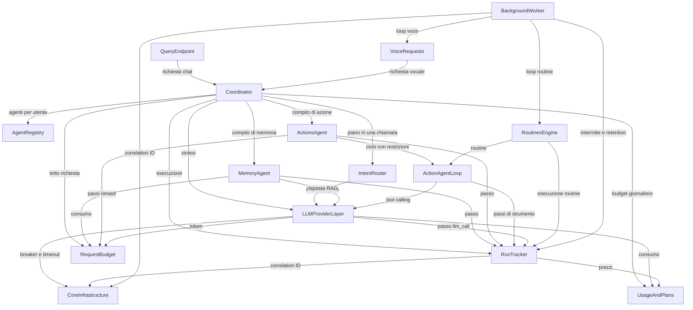
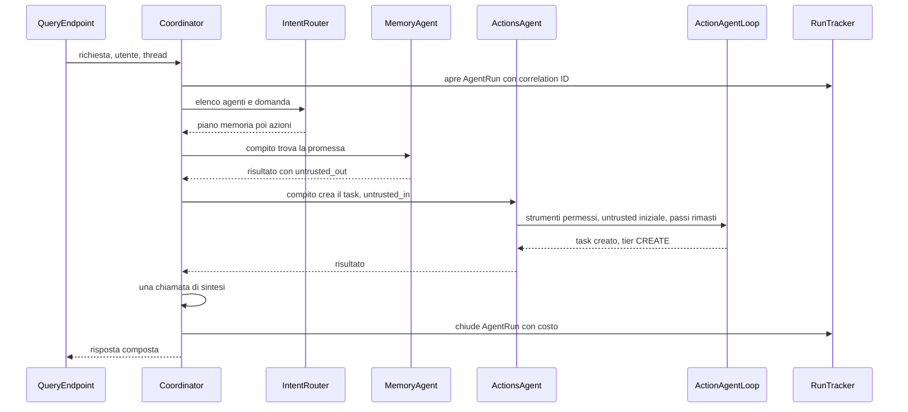

# Componenti — Coordinatore multi-agente per Echo

Catalogo dei blocchi di codice che questo lavoro crea o modifica. I moduli esistenti che restano invariati (Memory and RAG, Action Providers, Agent Own Tools, Assistants, Chat History, MCP Server) compaiono come `external_dependencies` di tipo `other`, con la nota "esistente, invariato": non sono infrastruttura, ma questo lavoro non ci scrive codice. Fonti: `inception/requirements-analysis/requirements.md`, `aidlc/spaces/default/codekb/echo/architecture.md`, `aidlc/spaces/default/codekb/echo/component-inventory.md`, risposte in `domain-design-questions.md`.

```yaml
components:
  - name: QueryEndpoint
    summary: Il router della chat Ask (POST /api/query, anche SSE) che passa le richieste al coordinatore quando la tappa è attiva.
    behaviour: >
      Con l'impostazione del coordinatore spenta si comporta esattamente come oggi. Accesa, mantiene
      idempotenza (query:req), caricamento della cronologia, salvataggio di un solo turno in chat_sessions
      e lo schema di QueryResponse/SSE, e delega al Coordinator la decisione e l'esecuzione. Non sceglie
      agenti e non chiama LLM da solo.
    responsibilities:
      - Contratto HTTP/SSE della chat verso l'app, invariato
      - Idempotenza per client_request_id e salvataggio del turno
      - Interruttore tra percorso di oggi e coordinatore
    depends_on:
      - component: Coordinator
        interaction: esegue la richiesta di chat e riceve la risposta composta
        style: sync
    dependents: []
    external_dependencies:
      - name: Chat History (esistente, invariato)
        kind: other
        purpose: cronologia del thread e contesto breve in Redis
      - name: Redis
        kind: cache
        purpose: marker di idempotenza query:req
    entities: []

  - name: VoiceRequests
    summary: Il worker delle richieste vocali "Ehi Echo" che, nella tappa voce, passa dal coordinatore.
    behaviour: >
      Mantiene wake word, raccolta del comando, verifica LLM che la frase sia rivolta a Echo, idempotenza
      voice:done e messaggio di fallimento. Al posto della scelta memoria/agente di oggi chiama il
      Coordinator con origine voice; il ramo foto resta com'è. Il correlation ID arriva nel payload della
      coda queue:voice.
    responsibilities:
      - Richieste vocali instradate dal coordinatore (tappa voce)
      - Messaggio di fallimento localizzato per richieste interrotte
    depends_on:
      - component: Coordinator
        interaction: esegue la richiesta vocale come una richiesta di chat con origine voice
        style: sync
    dependents:
      - component: BackgroundWorker
        interaction: ospita il loop della coda queue:voice
    external_dependencies:
      - name: Redis
        kind: queue
        purpose: queue:voice e voice:done
    entities: []

  - name: Coordinator
    summary: Riceve una richiesta, decide il percorso, delega agli agenti registrati e compone una sola risposta.
    behaviour: >
      Percorso veloce: senza indizi di strumenti e senza assistant risponde la MemoryAgent senza chiamate di
      instradamento (FR1.3). Altrimenti chiede all'IntentRouter un DelegationPlan in una chiamata ed esegue
      i passi in ordine, uno alla volta, a un solo livello (gli agenti non delegano). Prima di delegare
      controlla il budget giornaliero dell'utente; se superato usa solo il percorso veloce della Memoria con
      un messaggio localizzato. Apre una AgentRun, crea un RequestLimits per la richiesta, imposta usage_owner.
      Porta il flag non fidato: se un risultato torna con untrusted_out, i compiti successivi partono con
      untrusted_in, così l'agente Azioni blocca gli strumenti propri duraturi come oggi e gli invii restano
      pending_action. Un agente solo: la sua risposta passa così com'è; più agenti: una chiamata di sintesi.
      Il fallimento o il timeout di un agente produce una risposta parziale che lo dice; un agente
      sconosciuto o non disponibile diventa un passo fallito, mai un errore 500.
    responsibilities:
      - Percorso veloce e percorso delegato
      - Esecuzione sequenziale del piano e passaggio del contesto limitato agli agenti
      - Propagazione del flag non fidato tra un agente e il successivo
      - Composizione della risposta e risposte parziali
      - Timeout complessivo della richiesta
    depends_on:
      - component: AgentRegistry
        interaction: elenco degli agenti disponibili per l'utente e loro specifiche
        style: sync
      - component: IntentRouter
        interaction: un DelegationPlan in una chiamata
        style: sync
      - component: MemoryAgent
        interaction: compiti di memoria e percorso veloce
        style: sync
      - component: ActionsAgent
        interaction: compiti sulle app collegate e sugli assistenti
        style: sync
      - component: RunTracker
        interaction: apre e chiude la AgentRun, registra i passi di delega e sintesi
        style: sync
      - component: RequestBudget
        interaction: tetto di passi, token e scadenza della richiesta
        style: sync
      - component: UsageAndPlans
        interaction: verifica del budget giornaliero per piano
        style: sync
      - component: LLMProviderLayer
        interaction: chiamata di sintesi quando delega a più agenti
        style: sync
    dependents:
      - component: QueryEndpoint
        interaction: richieste di chat Ask
      - component: VoiceRequests
        interaction: richieste vocali
    external_dependencies: []
    entities:
      - name: AgentTask
        identifier: task_id
        attributes: [task_id, agent_id, instruction, language, thread_excerpt, personal_context, untrusted_in]
        references:
          - entity: AgentSpec
            owned_by: AgentRegistry
            relationship: ogni compito è rivolto a un solo agente del registro
      - name: AgentResult
        identifier: task_id
        attributes: [task_id, status, text, sources, pending_action_id, untrusted_out, tokens_in, tokens_out, cost_usd]

  - name: AgentRegistry
    summary: Elenco degli agenti nel codice, validato all'avvio, più gli assistenti dell'utente risolti a runtime.
    behaviour: >
      Ogni AgentSpec dichiara identificatore stabile, descrizione per l'instradamento, elenco chiuso di
      strumenti, livelli di strumento permessi (READ, CREATE, CONFIRM), limiti predefiniti e runner. Gli
      agenti di codice sono Memoria e Azioni; la ricerca web è uno strumento, non un agente. All'avvio di
      api e worker un identificatore duplicato o uno strumento inesistente fa fallire l'avvio con un errore
      che li nomina. Per ogni richiesta aggiunge, nella tappa Assistants, un AgentSpec per ciascun assistente
      dell'utente (letto per user_id), che usa il runner dell'agente Azioni con quel profilo. Un agente non
      ha mai più permessi del contesto: nelle routine i livelli CONFIRM e gli strumenti di routine sono tolti.
      L'interfaccia degli strumenti non dipende dalla sorgente (codice, Composio, telefono, WhatsApp), così
      una sorgente client MCP si potrà aggiungere senza cambiare l'AgentSpec.
    responsibilities:
      - Definizione e validazione degli agenti di codice
      - Risoluzione per utente degli agenti Assistants
      - Restrizione dei permessi in base al contesto chiamante
    depends_on: []
    dependents:
      - component: Coordinator
        interaction: elenco e specifiche degli agenti per la richiesta
    external_dependencies:
      - name: Assistants (esistente, invariato)
        kind: other
        purpose: profili degli assistenti dell'utente da esporre come agenti
      - name: PostgreSQL
        kind: database
        purpose: lettura della tabella assistants
    entities:
      - name: AgentSpec
        identifier: agent_id
        attributes: [agent_id, kind, description, allowed_tools, allowed_tiers, default_limits, runner, assistant_id]

  - name: IntentRouter
    summary: L'instradatore di oggi (actions/availability.py), esteso perché restituisca un piano di delega in una chiamata.
    behaviour: >
      Mantiene il pre-filtro a parole chiave e i messaggi fissi per app non collegate. Con l'elenco degli
      agenti ricevuto dal Coordinator, una sola chiamata complete_json restituisce il DelegationPlan: tipo di
      percorso (memory, notice, delegate, photo), gli agenti in ordine con il compito per ciascuno, il motivo.
      Un piano che nomina agenti fuori dall'elenco viene ripulito e il passo segnato come fallito dal
      Coordinator. Le conferme non dipendono mai dal piano: restano nella policy del codice.
    responsibilities:
      - Una chiamata di instradamento per richiesta delegata
      - Validazione strutturale del piano restituito dal modello
    depends_on:
      - component: LLMProviderLayer
        interaction: chiamata complete_json del servizio intent
        style: sync
    dependents:
      - component: Coordinator
        interaction: richiede il DelegationPlan
    external_dependencies:
      - name: Action Providers (esistente, invariato)
        kind: other
        purpose: elenco delle app collegate per i messaggi fissi
    entities:
      - name: DelegationPlan
        identifier: plan_id
        attributes: [plan_id, route_kind, steps, reason]

  - name: MemoryAgent
    summary: Agente Memoria, solo lettura, come il percorso di oggi (recupero senza LLM e una risposta).
    behaviour: >
      Chiama retrieve_memory_context e una chiamata di risposta (anche in streaming), senza ciclo di tool
      calling. Può usare la ricerca web solo se è nel suo elenco di strumenti, entro le 30 ricerche al
      giorno. Il risultato è sempre marcato untrusted_out, perché la memoria contiene parole di altre
      persone (stessa regola di oggi per search_memory). Ogni lettura filtra per user_id; in un assistente
      filtra sui suoi documenti.
    responsibilities:
      - Risposte dalla memoria e percorso veloce
      - Marcatura del risultato come non fidato
    depends_on:
      - component: LLMProviderLayer
        interaction: chiamata di risposta RAG
        style: sync
      - component: RunTracker
        interaction: passo di delega con esito, durata e costo
        style: sync
      - component: RequestBudget
        interaction: verifica e consumo del tetto prima della chiamata
        style: sync
    dependents:
      - component: Coordinator
        interaction: compiti di memoria
    external_dependencies:
      - name: Memory and RAG (esistente, invariato)
        kind: other
        purpose: retrieve_memory_context e prompt RAG
    entities: []

  - name: ActionsAgent
    summary: Adattatore che espone il ciclo dell'agente di oggi come agente Azioni (e, con un profilo, come agente Assistant).
    behaviour: >
      Traduce un AgentTask in una chiamata a run_action_agent passando l'elenco chiuso di strumenti
      dell'AgentSpec, il flag untrusted_in come stato iniziale, i passi rimasti come max_steps, la scadenza
      come timeout, l'eventuale assistant e il registratore dei passi. Restituisce un AgentResult con
      pending_action, fonti e untrusted_out. Non cambia policy, pending action né audit.
    responsibilities:
      - Adattamento AgentTask/AgentResult verso run_action_agent
      - Agenti Assistants tramite il profilo assistant
    depends_on:
      - component: ActionAgentLoop
        interaction: esegue il ciclo di tool calling con le restrizioni del compito
        style: sync
      - component: RunTracker
        interaction: passo di delega con esito
        style: sync
      - component: RequestBudget
        interaction: passi e tempo rimasti per il ciclo
        style: sync
    dependents:
      - component: Coordinator
        interaction: compiti di azione e degli assistenti
    external_dependencies: []
    entities: []

  - name: ActionAgentLoop
    summary: Il ciclo di oggi (actions/agent.py con policy, pending, audit), con quattro ingressi in più.
    behaviour: >
      Resta il solo punto in cui si eseguono strumenti con effetti. Aggiunge: un elenco di strumenti permessi
      (le chiamate fuori elenco sono rifiutate e registrate, senza contattare il provider); un flag untrusted
      iniziale; una scadenza; un registratore dei passi per le chiamate di strumento (argomenti oscurati come
      in audit.py, con riferimento alla riga action_log). La classificazione READ/CREATE/CONFIRM, le
      pending_action, _LASTING_OWN e lo stato unknown sugli esiti incerti restano identici. Gli strumenti con
      effetti non vengono mai ripetuti in automatico.
    responsibilities:
      - Esecuzione degli strumenti con la policy di conferma
      - Rifiuto degli strumenti fuori elenco
      - Registrazione dei passi di strumento
    depends_on:
      - component: LLMProviderLayer
        interaction: complete_with_tools a ogni passo
        style: sync
      - component: RunTracker
        interaction: registratore dei passi di strumento
        style: sync
    dependents:
      - component: ActionsAgent
        interaction: compiti delegati dal coordinatore
      - component: RoutinesEngine
        interaction: esecuzioni pianificate
    external_dependencies:
      - name: Action Providers (esistente, invariato)
        kind: other
        purpose: Composio, telefono, WhatsApp
      - name: Agent Own Tools (esistente, invariato)
        kind: other
        purpose: strumenti ECHO_*
      - name: PostgreSQL
        kind: database
        purpose: pending_actions e action_log
    entities: []

  - name: RequestBudget
    summary: Tetto di passi, token e tempo per una singola richiesta, condiviso tra coordinatore e agenti.
    behaviour: >
      Creato dal Coordinator per ogni richiesta con i valori delle impostazioni. Ogni chiamata LLM e ogni
      passo lo consumano; prima di una nuova chiamata si verifica che resti spazio. Superato il tetto,
      l'agente in corso si ferma e restituisce budget_exceeded, e il Coordinator risponde con ciò che ha.
      Vive solo in memoria per la durata della richiesta.
    responsibilities:
      - Contatori per richiesta e scadenza
      - Decisione "c'è ancora spazio" prima di ogni chiamata
    depends_on: []
    dependents:
      - component: Coordinator
        interaction: crea il budget e controlla la scadenza complessiva
      - component: MemoryAgent
        interaction: consumo prima della risposta
      - component: ActionsAgent
        interaction: passi e tempo rimasti
      - component: LLMProviderLayer
        interaction: addebito dei token di ogni chiamata
    external_dependencies: []
    entities:
      - name: RequestLimits
        identifier: run_id
        attributes: [run_id, max_steps, max_tokens, deadline, used_steps, used_tokens]

  - name: RunTracker
    summary: Esecuzioni e passi registrati in Postgres con correlation ID, comando operatore, chiusura delle esecuzioni interrotte.
    behaviour: >
      Apre una AgentRun per ogni richiesta del coordinatore e per ogni esecuzione di routine; registra i passi
      (piano, delega, chiamata LLM, chiamata di strumento, sintesi) tramite un contesto di esecuzione in una
      ContextVar, come già usage_owner. Gli argomenti degli strumenti sono oscurati come in actions/audit.py;
      niente corpi di messaggi. La scrittura usa una sessione propria, così un errore del tracciamento non fa
      fallire la richiesta e il tracciamento sopravvive al rollback della richiesta. All'avvio di api e worker,
      e poi ogni minuto nel worker, le esecuzioni ancora running oltre il timeout complessivo più un minuto
      diventano interrupted. Le righe più vecchie di 30 giorni sono cancellate dal worker di retention. Un
      comando operatore (make runs) mostra un'esecuzione per correlation ID o le ultime N di un utente, con
      costi per agente calcolati con i prezzi di usage_prices.py.
    responsibilities:
      - Righe AgentRun e AgentStep
      - Contesto di esecuzione corrente (ContextVar)
      - Chiusura delle esecuzioni interrotte e retention
      - Comando operatore e costo per agente
    depends_on:
      - component: CoreInfrastructure
        interaction: correlation ID e sessioni del database
        style: sync
      - component: UsageAndPlans
        interaction: prezzi per modello per il costo stimato
        style: sync
    dependents:
      - component: Coordinator
        interaction: apertura e chiusura dell'esecuzione
      - component: MemoryAgent
        interaction: passi di delega
      - component: ActionsAgent
        interaction: passi di delega
      - component: ActionAgentLoop
        interaction: passi di strumento
      - component: RoutinesEngine
        interaction: esecuzioni di routine
      - component: BackgroundWorker
        interaction: chiusura delle interrotte e retention
      - component: LLMProviderLayer
        interaction: passi di chiamata LLM
    external_dependencies:
      - name: PostgreSQL
        kind: database
        purpose: tabelle agent_runs e agent_steps
    entities:
      - name: AgentRun
        identifier: run_id
        attributes: [run_id, correlation_id, user_id, source, status, plan_summary, started_at, ended_at, tokens_in, tokens_out, cost_usd, error_class]
      - name: AgentStep
        identifier: step_id
        attributes: [step_id, run_id, seq, kind, agent_id, tool_name, tier, attempt, started_at, duration_ms, tokens_in, tokens_out, cost_usd, status, error_class, args_redacted, action_log_id]
        references:
          - entity: AgentSpec
            owned_by: AgentRegistry
            relationship: ogni passo di delega o di strumento nomina al più un agente

  - name: UsageAndPlans
    summary: Consumo e piani di oggi, con in più il budget giornaliero di costo LLM per piano.
    behaviour: >
      Il budget giornaliero di un utente è il limite in USD del suo piano (free, plus, unlimited) confrontato
      con il costo stimato del giorno calcolato da llm_usage e usage_prices.py. I limiti sono impostazioni,
      provvisori finché i costi non sono misurati. Il controllo è una lettura: nessuna tabella nuova.
    responsibilities:
      - Budget giornaliero per piano
      - Prezzi per modello (esistenti)
    depends_on: []
    dependents:
      - component: Coordinator
        interaction: verifica del budget prima di delegare
      - component: RunTracker
        interaction: prezzi per il costo dei passi
      - component: LLMProviderLayer
        interaction: registrazione del consumo per utente (esistente)
    external_dependencies:
      - name: PostgreSQL
        kind: database
        purpose: llm_usage
    entities:
      - name: DailyLlmBudget
        identifier: user_id_day
        attributes: [user_id, day, plan, limit_usd, spent_usd]

  - name: LLMProviderLayer
    summary: Il layer LLM di oggi, con timeout, retry e circuit breaker per provider anche sul percorso sincrono, e con i passi LLM registrati.
    behaviour: >
      Ogni chiamata ha un timeout; gli errori transitori (timeout, 429, 5xx) sono ripetuti con backoff e
      jitter entro un numero massimo di tentativi; un breaker per provider (LLM OpenAI separato da STT
      Deepgram e OpenAI) fa fallire subito quando è aperto. Dopo ogni chiamata, oltre a registrare il consumo
      per utente come oggi, addebita i token al RequestBudget corrente e registra un passo llm_call nel
      contesto di esecuzione, se ce n'è uno.
    responsibilities:
      - Resilienza delle chiamate LLM
      - Addebito dei token e passi LLM
    depends_on:
      - component: CoreInfrastructure
        interaction: breaker per provider e impostazioni di timeout
        style: sync
      - component: RunTracker
        interaction: passo llm_call nel contesto di esecuzione
        style: sync
      - component: RequestBudget
        interaction: addebito dei token
        style: sync
      - component: UsageAndPlans
        interaction: consumo per utente in llm_usage
        style: sync
    dependents:
      - component: Coordinator
        interaction: sintesi
      - component: IntentRouter
        interaction: piano di delega
      - component: MemoryAgent
        interaction: risposta RAG
      - component: ActionAgentLoop
        interaction: tool calling
    external_dependencies:
      - name: OpenAI API
        kind: third-party-api
        purpose: chiamate dei modelli
    entities: []

  - name: CoreInfrastructure
    summary: Impostazioni, log e breaker di oggi, con correlation ID propagabile e breaker per provider.
    behaviour: >
      Aggiunge le impostazioni del coordinatore (interruttori per tappa, tetti, timeout, budget per piano),
      un breaker per provider al posto del solo openai_breaker condiviso, e due funzioni per mettere il
      correlation ID in un payload di coda e ripristinarlo nel worker. Il correlation ID resta una ContextVar
      letta dal logger JSON.
    responsibilities:
      - Impostazioni del coordinatore
      - Breaker per provider
      - Propagazione del correlation ID attraverso le code
    depends_on: []
    dependents:
      - component: BackgroundWorker
        interaction: ripristino del correlation ID dai payload
      - component: RunTracker
        interaction: correlation ID e sessioni
      - component: LLMProviderLayer
        interaction: breaker e timeout
    external_dependencies: []
    entities: []

  - name: RoutinesEngine
    summary: Le routine di oggi, tracciate come esecuzioni anche se non passano dal coordinatore.
    behaviour: >
      Continua a chiamare il ciclo dell'agente con owned_by, timeout 60 s, allow_confirm=false e senza
      strumenti di routine, e a registrare routine_runs. In più apre una AgentRun con origine routine,
      così passi, costi e fallimenti si vedono come per la chat.
    responsibilities:
      - Esecuzioni di routine tracciate
    depends_on:
      - component: ActionAgentLoop
        interaction: esegue la routine
        style: sync
      - component: RunTracker
        interaction: esecuzione con origine routine
        style: sync
    dependents:
      - component: BackgroundWorker
        interaction: ospita il loop delle routine
    external_dependencies: []
    entities: []

  - name: BackgroundWorker
    summary: Il processo worker di oggi, che in più propaga il correlation ID e ospita chiusura delle interrotte e retention del tracciamento.
    behaviour: >
      I produttori mettono il correlation ID nel payload di queue:stt, queue:analysis e queue:voice; i loop lo
      ripristinano prima di elaborare. All'avvio e ogni minuto chiede al RunTracker di chiudere le
      esecuzioni interrotte; il worker di retention cancella le righe di tracciamento oltre 30 giorni.
    responsibilities:
      - Correlation ID nei job
      - Ospitare chiusura delle interrotte e retention
    depends_on:
      - component: RunTracker
        interaction: chiusura delle interrotte e retention
        style: async
      - component: CoreInfrastructure
        interaction: ripristino del correlation ID
        style: sync
      - component: VoiceRequests
        interaction: loop della coda vocale
        style: async
      - component: RoutinesEngine
        interaction: loop delle routine
        style: async
    dependents: []
    external_dependencies:
      - name: Redis
        kind: queue
        purpose: code dei job
    entities: []
```

## Component Diagram


<!-- Text fallback: QueryEndpoint e VoiceRequests passano le richieste al Coordinator. Il Coordinator usa AgentRegistry per l'elenco degli agenti, IntentRouter per il piano in una chiamata, MemoryAgent e ActionsAgent per eseguire i compiti, RunTracker per registrare l'esecuzione, RequestBudget per il tetto della richiesta, UsageAndPlans per il budget giornaliero e LLMProviderLayer per la sintesi. ActionsAgent avvolge ActionAgentLoop. IntentRouter, MemoryAgent, ActionAgentLoop e Coordinator chiamano LLMProviderLayer, che registra i passi LLM nel RunTracker, addebita i token al RequestBudget, registra il consumo in UsageAndPlans e usa breaker e timeout di CoreInfrastructure. RoutinesEngine usa ActionAgentLoop e RunTracker. BackgroundWorker ospita i loop di voce e routine, ripristina il correlation ID e chiede al RunTracker di chiudere le esecuzioni interrotte e cancellare quelle vecchie. -->

### Sequenza: "cosa mi ha promesso Marco? aggiungilo a Todoist"


<!-- Text fallback: il QueryEndpoint passa la richiesta al Coordinator, che apre l'esecuzione e chiede un piano all'IntentRouter; il piano dice memoria poi azioni. La MemoryAgent trova la promessa e la restituisce marcata non fidata. L'ActionsAgent riceve il compito con il flag non fidato e avvolge il ciclo dell'agente, che crea il task su Todoist perché la creazione è permessa anche dopo contenuti non fidati (sono bloccati solo gli strumenti propri duraturi e gli invii chiedono Confirm). Il Coordinator unisce i due risultati con una chiamata di sintesi, chiude l'esecuzione con il costo e restituisce la risposta. -->

## Component Summary

| Component | Purpose | Depends On | Dependents | Entities Owned |
|---|---|---|---|---|
| QueryEndpoint | Chat Ask verso il coordinatore, contratto invariato | Coordinator | — | — |
| VoiceRequests | Richieste vocali verso il coordinatore (tappa voce) | Coordinator | BackgroundWorker | — |
| Coordinator | Decide, delega, compone | AgentRegistry, IntentRouter, MemoryAgent, ActionsAgent, RunTracker, RequestBudget, UsageAndPlans, LLMProviderLayer | QueryEndpoint, VoiceRequests | AgentTask, AgentResult |
| AgentRegistry | Agenti di codice e assistenti per utente | — | Coordinator | AgentSpec |
| IntentRouter | Piano di delega in una chiamata | LLMProviderLayer | Coordinator | DelegationPlan |
| MemoryAgent | Risposte dalla memoria, solo lettura | LLMProviderLayer, RunTracker, RequestBudget | Coordinator | — |
| ActionsAgent | Adattatore verso il ciclo dell'agente | ActionAgentLoop, RunTracker, RequestBudget | Coordinator | — |
| ActionAgentLoop | Ciclo di oggi con elenco chiuso e registratore | LLMProviderLayer, RunTracker | ActionsAgent, RoutinesEngine | — |
| RequestBudget | Tetto per richiesta | — | Coordinator, MemoryAgent, ActionsAgent, LLMProviderLayer | RequestLimits |
| RunTracker | Esecuzioni e passi, interrotte, comando operatore | CoreInfrastructure, UsageAndPlans | Coordinator, MemoryAgent, ActionsAgent, ActionAgentLoop, RoutinesEngine, BackgroundWorker, LLMProviderLayer | AgentRun, AgentStep |
| UsageAndPlans | Budget giornaliero per piano | — | Coordinator, RunTracker, LLMProviderLayer | DailyLlmBudget |
| LLMProviderLayer | Resilienza e passi LLM | CoreInfrastructure, RunTracker, RequestBudget, UsageAndPlans | Coordinator, IntentRouter, MemoryAgent, ActionAgentLoop | — |
| CoreInfrastructure | Impostazioni, breaker per provider, correlation ID | — | BackgroundWorker, RunTracker, LLMProviderLayer | — |
| RoutinesEngine | Routine tracciate | ActionAgentLoop, RunTracker | BackgroundWorker | — |
| BackgroundWorker | Correlation ID nei job, interrotte, retention | RunTracker, CoreInfrastructure, VoiceRequests, RoutinesEngine | — | — |

## Entity Ownership

| Entity | Owning Component | Identifier | Attributes | References |
|---|---|---|---|---|
| AgentTask | Coordinator | task_id | agent_id, instruction, language, thread_excerpt, personal_context, untrusted_in | AgentSpec (AgentRegistry) |
| AgentResult | Coordinator | task_id | status, text, sources, pending_action_id, untrusted_out, tokens_in, tokens_out, cost_usd | — |
| AgentSpec | AgentRegistry | agent_id | kind, description, allowed_tools, allowed_tiers, default_limits, runner, assistant_id | — |
| DelegationPlan | IntentRouter | plan_id | route_kind, steps, reason | — |
| RequestLimits | RequestBudget | run_id | max_steps, max_tokens, deadline, used_steps, used_tokens | — |
| AgentRun | RunTracker | run_id | correlation_id, user_id, source, status, plan_summary, started_at, ended_at, tokens_in, tokens_out, cost_usd, error_class | — |
| AgentStep | RunTracker | step_id | run_id, seq, kind, agent_id, tool_name, tier, attempt, started_at, duration_ms, tokens_in, tokens_out, cost_usd, status, error_class, args_redacted, action_log_id | AgentSpec (AgentRegistry) |
| DailyLlmBudget | UsageAndPlans | user_id_day | user_id, day, plan, limit_usd, spent_usd | — |

Solo AgentRun e AgentStep diventano tabelle nuove (`agent_runs`, `agent_steps`, migrazione additiva). Gli altri sono oggetti in memoria o valori calcolati; DailyLlmBudget si calcola da `llm_usage`.

## External Dependencies

| Component | Dependency | Kind | Purpose |
|---|---|---|---|
| QueryEndpoint | Chat History (esistente, invariato) | other | cronologia e contesto breve |
| QueryEndpoint | Redis | cache | idempotenza query:req |
| VoiceRequests | Redis | queue | queue:voice, voice:done |
| AgentRegistry | Assistants (esistente, invariato) | other | profili degli assistenti |
| AgentRegistry | PostgreSQL | database | tabella assistants |
| IntentRouter | Action Providers (esistente, invariato) | other | app collegate |
| MemoryAgent | Memory and RAG (esistente, invariato) | other | recupero e prompt RAG |
| ActionAgentLoop | Action Providers (esistente, invariato) | other | Composio, telefono, WhatsApp |
| ActionAgentLoop | Agent Own Tools (esistente, invariato) | other | strumenti ECHO_* |
| ActionAgentLoop | PostgreSQL | database | pending_actions, action_log |
| RunTracker | PostgreSQL | database | agent_runs, agent_steps |
| UsageAndPlans | PostgreSQL | database | llm_usage |
| LLMProviderLayer | OpenAI API | third-party-api | modelli |
| BackgroundWorker | Redis | queue | code dei job |

Il server MCP non compare: resta invariato (FR10.1) e non dipende da nessun componente di questo catalogo.

## Rationale

| Component | Perché è un blocco separato |
|---|---|
| Coordinator | Responsabilità nuova (decidere e comporre) con un ritmo di cambiamento diverso dagli agenti; è l'unico che conosce più agenti |
| AgentRegistry | Dati di configurazione validati all'avvio, letti da tutti; separarlo rende i permessi verificabili in un solo punto (ADR-006) |
| IntentRouter | Esiste già; estenderlo evita un secondo instradatore e tiene una chiamata per richiesta (ADR-002) |
| MemoryAgent | Percorso di sola lettura con costo e latenza propri; separato dall'agente Azioni perché non deve mai avere strumenti con effetti (ADR-004) |
| ActionsAgent | Adattatore sottile: isola il coordinatore dall'interfaccia di run_action_agent e lascia invariato il codice delle conferme (ADR-003) |
| ActionAgentLoop | Esiste già ed è il solo punto con effetti; cambia solo negli ingressi, non nella policy |
| RequestBudget | Concetto trasversale usato da quattro componenti; tenerlo a parte evita che ognuno conti a modo suo (ADR-008) |
| RunTracker | Dati propri (agent_runs, agent_steps) con ciclo di vita e retention propri, diversi dall'audit delle azioni e dal consumo giornaliero (ADR-007) |
| UsageAndPlans | Esiste già e possiede prezzi e piani: il budget giornaliero sta dove stanno i piani (ADR-008) |
| LLMProviderLayer | Esiste già; la resilienza va dove partono le chiamate, così vale per tutti i chiamanti (ADR-010) |
| CoreInfrastructure, RoutinesEngine, BackgroundWorker, QueryEndpoint, VoiceRequests | Esistono già; cambiano solo nei punti di aggancio |

**Alternatives Rejected** (decomposizione): un package unico "agents" con coordinatore, registro e tracciamento in un solo modulo (meno file, ma tracciamento e permessi diventerebbero difficili da testare da soli); un componente separato per gli agenti Assistants (duplicherebbe l'adattatore Azioni: un assistente è un profilo dello stesso ciclo, ADR-009); un servizio coordinatore separato (ADR-001). La scelta di un package nuovo `backend/app/agents/` per Coordinator, AgentRegistry, MemoryAgent, ActionsAgent, RequestBudget e RunTracker è la risposta Q5.

**Fuori da questo catalogo, per i requisiti:** la cancellazione delle righe di tracciamento alla cancellazione di un account seguirà il percorso di cancellazione quando esisterà (oggi Echo non ne ha uno); fino ad allora la retention di 30 giorni è l'unico limite. Le soglie dei breaker e i valori dei tetti si fissano in NFR Requirements.
