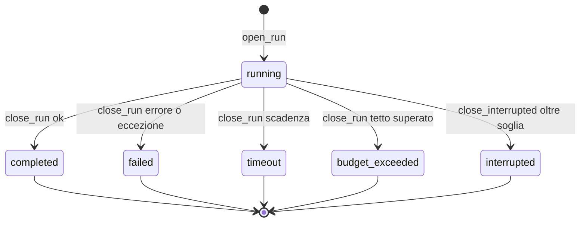
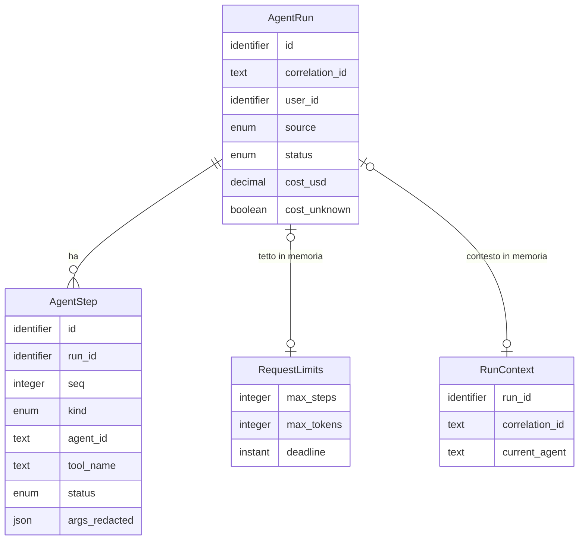

# Specifica funzionale — U1 u1-run-foundation

La base tecnica di tracciamento e tetto per richiesta su cui poggiano le altre unità. Fonti: `inception/units-generation/unit-of-work.md` (U1), `inception/contract-design/contract-summary.md` (C1–C4), `inception/domain-design/components.md` (RunTracker, RequestBudget, CoreInfrastructure), `inception/requirements-analysis/requirements.md`. Entità in `entities.md`, regole in `rules.md`. Non esiste `stories.md`: U1 risponde ai requisiti FR7.1, FR7.6, FR8.1, FR8.2, FR8.3, FR8.4, FR8.6, FR9.1, FR11.1, FR11.2, FR11.3.

## Flussi

### F1 — Aprire e chiudere una esecuzione

1. Il chiamante (coordinatore in U4, routine in U3) chiama `open_run(user_id, source, correlation_id)`.
2. Se `run_tracking_enabled` è falso, restituisce un RunContext senza `run_id` e lo mette nella ContextVar (BR5.1). Fine.
3. Altrimenti apre una sessione propria, inserisce una AgentRun `running` e fa commit (BR1.6).
4. Se l'inserimento fallisce, registra l'errore nei log con il correlation_id e restituisce un RunContext senza `run_id` (BR1.5).
5. Il chiamante lavora; i passi si registrano con F2.
6. Alla fine il chiamante chiama `close_run(run, status, plan_summary, error_class)`: totali di token e costo da RunContext, `ended_at` adesso, solo se la run è ancora `running` (BR1.2). `plan_summary` contiene solo identificatori di agenti (BR1.7).
7. Se il chiamante solleva un'eccezione prima della chiusura, chiude con `failed` e la classe dell'eccezione in un blocco `finally` (U3 e U4 lo usano tramite un context manager `run_scope`).

### F2 — Registrare un passo

1. Il chiamante chiama `record_step(...)` con tipo, agente, strumento, livello, stato, durata, token, modello, tentativo, errore, argomenti, riferimento ad `action_log`.
2. Se non c'è una run corrente con `run_id`, non fa nulla (BR1.4).
3. Assegna `seq` (BR1.3), oscura gli argomenti (BR1.7), calcola il costo (BR1.8), somma token e costo nel RunContext.
4. Scrive l'AgentStep con una sessione propria; un errore va nei log e non risale (BR1.5).

### F3 — Chiamata al modello (aggancio in `record_usage`)

1. Il layer LLM, dopo ogni chiamata, chiama `record_usage(kind, model, input_units, output_units, cached_units, duration_ms=?, attempt=?)`.
2. Se `kind` inizia con `llm_`: `charge_tokens(input_units + output_units)` sul tetto corrente (BR3.2), poi `record_step(kind=llm_call, agent_id=RunContext.current_agent, model, token, duration_ms, attempt)` (BR3.7). Entrambe le operazioni sono fuori dal blocco che ignora gli errori della scrittura su `llm_usage` e ciascuna è protetta a parte (BR3.6).
3. Poi la scrittura su `llm_usage` di oggi, invariata.

### F4 — Tetto della richiesta

1. Il coordinatore chiama `start_budget(max_steps, max_tokens, timeout_seconds)`: crea RequestLimits con `deadline = adesso_monotono + timeout` e lo mette nella ContextVar.
2. Prima di ogni chiamata al modello e di ogni strumento, il chiamante chiama `check()` (BR3.4):
   - `ok` → `charge_step()` (BR3.3) e prosegue;
   - `deadline_passed` → non inizia la chiamata e restituisce `timeout`;
   - `tokens_exhausted` o `steps_exhausted` → non inizia la chiamata e restituisce `budget_exceeded`.
3. Una chiamata già partita finisce sempre e i suoi token si addebitano (BR3.5).
4. Senza tetto corrente (routine e worker di oggi) controlli e addebiti non hanno effetto (BR3.1).

### F5 — Correlation ID attraverso le code

1. Il produttore (router dei Segment per `queue:stt`, worker STT per `queue:analysis` e `queue:voice`) costruisce il payload come oggi e lo passa a `with_correlation(payload)` prima di `lpush` (BR4.1).
2. Il consumatore, appena prelevato il payload, chiama `restore_correlation(payload)` (BR4.2): imposta la ContextVar dal campo, o ne crea uno nuovo se manca.
3. I log JSON del worker e i passi registrati portano lo stesso correlation ID del caricamento.

### F6 — Chiudere le esecuzioni interrotte

1. All'avvio di `api` (lifespan) e di `worker` (`workers/main.py`) si chiama `close_interrupted(older_than_seconds=run_interrupted_after_seconds)` (BR2.3).
2. Il worker avvia un task che ripete la chiamata ogni 60 secondi fino allo shutdown, come gli altri loop.
3. Ogni chiamata è una sola UPDATE condizionata (BR2.1); il numero di run chiuse va nei log.
4. All'avvio si registra un avviso se la soglia è minore del timeout complessivo più 85 secondi (BR2.2).

### F7 — Retention

1. `run_retention_loop` di oggi, a ogni giro, chiama `purge_older_than(days=30)` (BR5.3).
2. Le AgentStep si cancellano per cascade con la loro run.

### F8 — `make runs`

1. `make runs CID=<correlation_id>` → stampa la run (origine, stato, durata, token, costo stimato) e i passi in ordine di `seq` (tipo, agente, strumento, livello, stato, durata, token, costo, tentativo).
2. `make runs USER=<email o id> [LAST=N]` → le ultime N run (predefinito 10) con un riepilogo per run e costo per agente.
3. Il costo è sempre indicato come stima; se `cost_unknown`, accanto compare "(costo parziale)" (BR1.8).
4. Argomenti mancanti, utente o correlation ID inesistente → messaggio chiaro, codice di uscita diverso da 0 (BR6.1).

## Stato di AgentRun

<!-- Text fallback: una AgentRun nasce running con open_run; da running passa una sola volta a completed, failed, timeout o budget_exceeded con close_run, oppure a interrupted con close_interrupted quando supera la soglia; gli stati finali non cambiano più. -->

| Stato attuale | Evento | Condizione | Stato successivo | Azioni |
|---|---|---|---|---|
| running | close_run(completed) | status ancora running | completed | ended_at, totali |
| running | close_run(failed) | eccezione o errore del chiamante | failed | ended_at, error_class |
| running | close_run(timeout) | check ha restituito deadline_passed | timeout | ended_at |
| running | close_run(budget_exceeded) | check ha restituito tokens/steps_exhausted | budget_exceeded | ended_at |
| running | close_interrupted | started_at < adesso − soglia | interrupted | ended_at, error_class = interrupted |
| stato finale | qualsiasi chiusura | — | invariato | avviso nei log (BR1.2) |

## Interfacce

Le firme sono quelle di C1–C3 in `contract-summary.md`, con tre aggiunte additive:

- `record_step(..., model: str | None)` e i campi `model`, `cost_unknown` di AgentStep e AgentRun (`entities.md`).
- `record_usage(..., duration_ms: int | None = None, attempt: int | None = None)`.
- `run_scope(user_id, source)`: context manager asincrono che chiama `open_run` all'ingresso e `close_run` all'uscita (`failed` se esce con un'eccezione), più `agent_scope(agent_id)` che imposta `RunContext.current_agent` per la durata di un agente.

## Errori

| Condizione | Comportamento |
|---|---|
| Database non raggiungibile in open_run | log con correlation_id; RunContext senza run_id; la richiesta prosegue (BR1.5) |
| Database non raggiungibile in record_step o close_run | log; nessun effetto sulla richiesta (BR1.5) |
| close_run su run già chiusa | stato invariato; avviso nei log (BR1.2) |
| Modello senza prezzo | costo 0 con cost_unknown (BR1.8) |
| Payload di coda senza correlation_id | nuovo correlation_id (BR4.2) |
| make runs senza argomenti o con valori inesistenti | messaggio e codice di uscita ≠ 0 (BR6.1) |

## Diagramma delle entità (derivato da `entities.md`)

<!-- Text fallback: una AgentRun ha zero o più AgentStep; RequestLimits e RunContext sono oggetti in memoria legati al più a una AgentRun. -->

## Riepilogo delle regole (derivato da `rules.md`)

- **Esecuzioni e passi (BR1.1–BR1.9):** run solo per lavoro nuovo, stato finale una volta sola, passi numerati, errori del tracciamento mai fatali, sessione propria, argomenti oscurati, costo stimato con prezzi ignoti segnalati, confini di import verificati.
- **Interrotte (BR2.1–BR2.3):** running oltre 180 s → interrupted, all'avvio e ogni 60 s.
- **Tetto (BR3.1–BR3.7):** solo dentro una richiesta, solo i `kind` `llm_` consumano token, controllo scadenza → token → passi, superamento massimo di una chiamata, addebito fuori dal blocco che ignora gli errori.
- **Correlation ID (BR4.1–BR4.2):** nei payload delle code, ripristinato dai consumatori.
- **Rilascio (BR5.1–BR5.3):** interruttore spento, migrazione additiva, retention 30 giorni.
- **Operatore (BR6.1):** `make runs`.

## Punti aperti

- Valori di `max_steps`, `max_tokens` e del timeout complessivo: NFR Requirements (C2).
- La soglia di 180 s presuppone una chiamata al modello entro 30 s, che U2 deve garantire; se U2 sceglie un valore diverso, la soglia si aggiorna.
- FR11.2 (ordine delle tappe) non è una regola di questa unità: è fissato in `inception/delivery-planning/bolt-plan.md`.
