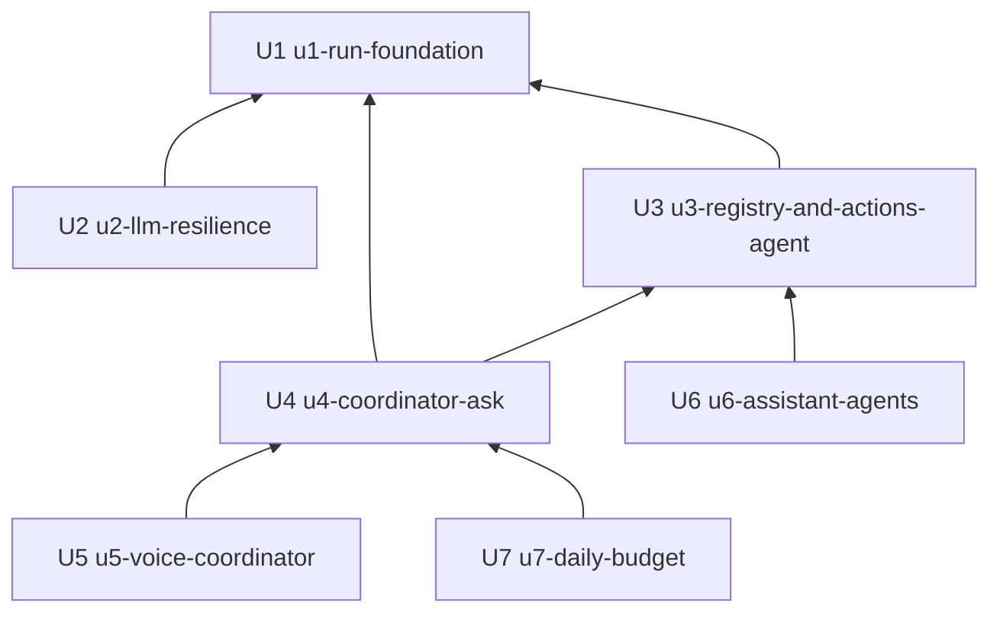

# Dipendenze tra le unità di lavoro

Una unità dipende da un'altra quando il suo codice o i suoi test hanno bisogno del codice dell'altra per funzionare. Le unità senza un arco tra loro si possono costruire nello stesso momento, ognuna sulla propria copia del progetto: il codice e i test di ciascuna passano con il suo codice, quello delle unità da cui dipende e il progetto com'è oggi. Questo documento descrive solo la topologia: l'ordine di consegna lo sceglie Delivery Planning.

```yaml
units:
  - name: u1-run-foundation
    kind: library
    depends_on: []
  - name: u2-llm-resilience
    kind: library
    depends_on: [u1-run-foundation]
  - name: u3-registry-and-actions-agent
    kind: library
    depends_on: [u1-run-foundation]
  - name: u4-coordinator-ask
    kind: service
    depends_on: [u1-run-foundation, u3-registry-and-actions-agent]
  - name: u5-voice-coordinator
    kind: service
    depends_on: [u4-coordinator-ask]
  - name: u6-assistant-agents
    kind: library
    depends_on: [u3-registry-and-actions-agent]
  - name: u7-daily-budget
    kind: library
    depends_on: [u4-coordinator-ask]
```

## DAG


<!-- Text fallback: U2, U3 e U4 dipendono da U1; U4 dipende anche da U3; U5 e U7 dipendono da U4; U6 dipende da U3. Le frecce vanno dall'unità che dipende all'unità da cui dipende. -->

## Perché ogni arco

| Unità | Dipende da | Motivo |
|---|---|---|
| U2 | U1 | registra i passi `llm_call` e addebita i token tramite il contesto di esecuzione e il RequestLimits di U1 |
| U3 | U1 | il ciclo dell'agente registra i passi di strumento e le routine aprono una esecuzione con il RunTracker di U1 |
| U4 | U1 | il Coordinator apre esecuzione e budget per richiesta |
| U4 | U3 | il Coordinator legge gli agenti dal registro e delega all'agente Azioni |
| U5 | U4 | la voce chiama il Coordinator |
| U6 | U3 | gli assistenti diventano AgentSpec nel registro ed eseguono con l'adattatore Azioni |
| U7 | U4 | il controllo del budget giornaliero si aggancia al Coordinator |

U4 non dipende da U2: il Coordinator usa l'interfaccia `LLMService` di oggi, che U2 rende più robusta senza cambiarla. Lo stesso vale per U3 e U6.

## Punti di integrazione

| Tra | Integrazione | Forma |
|---|---|---|
| U1 → tutte | contesto di esecuzione e RequestLimits in ContextVar (`core/runs.py`, `core/request_budget.py`) | chiamate Python nello stesso processo |
| U1 → U5 | correlation ID nei payload delle code Redis | campo nel payload JSON di queue:voice |
| U2 ↔ U1 | passo `llm_call` e addebito dei token dopo ogni chiamata al modello | chiamate Python, nessun dato condiviso oltre alle tabelle di U1 |
| U3 → U4 | AgentSpec, AgentTask, AgentResult | tipi Python condivisi in `agents/` |
| U4 → U7 | verifica del budget giornaliero prima di delegare | funzione in `services/usage.py` |
| U3 → U6 | AgentSpec con profilo assistente | stesso tipo, nuova sorgente nel registro |
| Tutte → PostgreSQL | `agent_runs`, `agent_steps` (scritte solo da U1) | tabelle possedute da RunTracker |

## Sviluppo in parallelo

Gruppi senza archi tra loro, costruibili insieme una volta pronte le loro dipendenze:

- dopo U1: **U2** e **U3**;
- dopo U3: **U4** e **U6** (U4 richiede anche U1, già pronta);
- dopo U4: **U5** e **U7**.

Più ordini topologici sono validi, per esempio U1, U3, U2, U4, U6, U7, U5 oppure U1, U2, U3, U6, U4, U5, U7.
